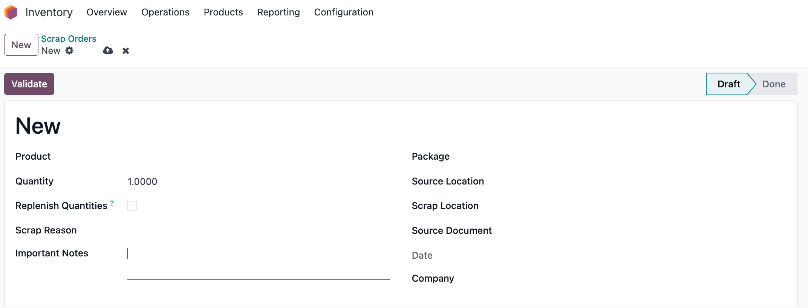
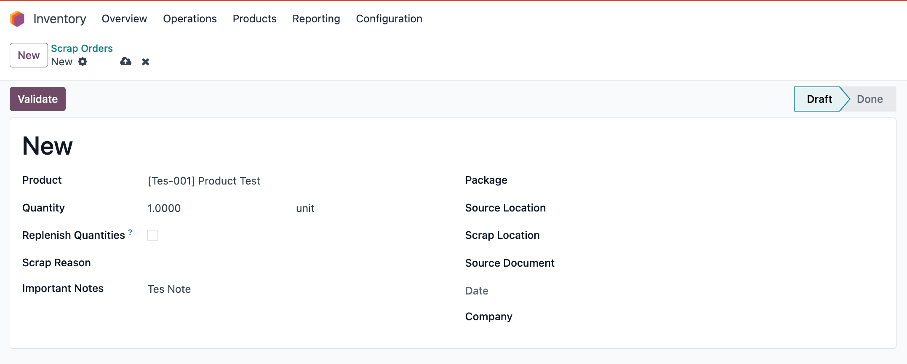
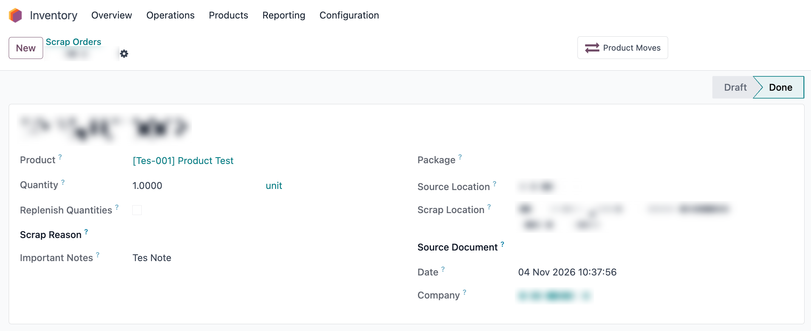
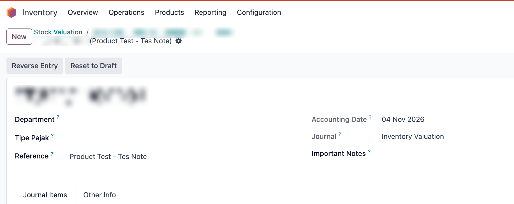

<div align="center">

# Inventory Scrap Note Integration

**Odoo module that adds an "Important Notes" field to Inventory Scrap and carries the note into the stock valuation journal entry.**

[](https://www.gnu.org/licenses/lgpl-3.0)
[](https://www.odoo.com/documentation/18.0/)
[](https://www.yazid-bustomi.my.id/)

</div>

---

## 📝 Overview

When stock is scrapped, the warehouse team usually knows why, but the accounting team only sees a journal entry with a product name. This module closes that gap: the reason written on the scrap order is copied to the **Reference** of the stock valuation journal entry (`account.move`) when the scrap is validated, so the note is visible during reconciliation and audits.

## ✨ Features

1. **"Important Notes" field on the scrap form**
   Adds a text field (`notes_journal_scrapt`) to `stock.scrap`, placed under Scrap Reason. It becomes read-only once the scrap is done.

2. **Note copied to the journal entry on validation**
   After the standard validation, the module finds the valuation journal entries linked to the scrap's stock move.

3. **Appended to the Reference**
   The note is added to the end of the journal entry's `ref` field.
   - **Format**: `[Original Reference] - [Important Notes]`
   - **Example**: `Product Test - Tes Note`

## 📸 Screenshots

> Company-specific data (document numbers, product names, locations and company name) is blurred. The product and note shown are test data.

**1. New scrap order with the Important Notes field**



**2. Scrap order filled in with a note**



**3. Scrap validated (Done); the note stays on the scrap order**



**4. Stock valuation journal entry; the note is appended to the Reference**



The Reference `Product Test - Tes Note` comes from the original reference (`Product Test`) plus the note written on the scrap order (`Tes Note`).

## ⚙️ Dependencies

Install these modules first:
- `stock_account`
- `account`

The note is only written to a journal entry when the product uses automated (real-time) inventory valuation, because that is when Odoo creates a valuation entry for the scrap.

## 🚀 Installation

1. Click the **Code** button on this repository and select **Download ZIP** (or clone the repository).
2. Extract the downloaded ZIP file.
3. Rename the extracted folder to exactly: `inventory_scrapt_notes` (Odoo uses the folder name as the module name).
4. Copy the `inventory_scrapt_notes` folder into your Odoo `addons` directory.
5. Restart the Odoo server.
6. Log in as an administrator and activate **Developer Mode** (Settings > Activate the developer mode).
7. Go to **Apps** and click **Update Apps List**.
8. Remove the default "Apps" filter in the search bar.
9. Search for `Inventory Scrap Notes` and click **Install**.

## 💻 Usage

1. Go to **Inventory > Operations > Scrap** and create a new scrap order.
2. Fill in the product, quantity, locations and other standard fields.
3. Write the reason or context in **Important Notes**.
4. Click **Validate**.
5. Open the stock valuation journal entry (from **Accounting > Journal Entries**, or from the product's stock valuation).
6. The **Reference** now ends with the note you wrote.

## 📁 Structure

```
inventory_scrapt_notes/
├── __init__.py
├── __manifest__.py
├── models/
│   └── stock_scrap.py              # field + action_validate override
├── views/
│   └── stock_scrap_form_views.xml  # field on the scrap form
└── static/description/screenshots/ # README images
```

## 📄 License

This module is licensed under **LGPL-3**.

---

<div align="center">
  <b>Developed by <a href="https://www.yazid-bustomi.my.id/">A Yazid Bustomi</a></b>
</div>
